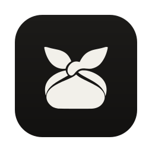
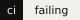
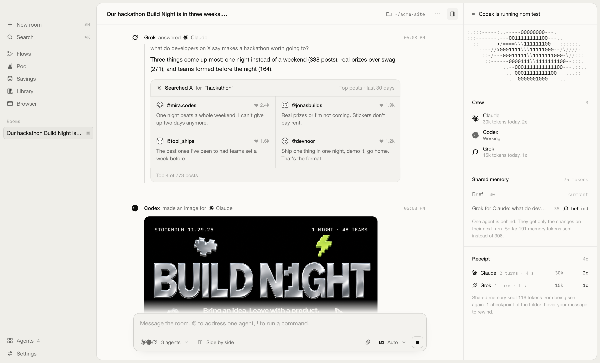

<p align="center">
  
</p>

<h1 align="center">Lunchbox</h1>

<p align="center">
  The AI tools you already pay for, working together in one room.
</p>

<p align="center">
  <a href="https://github.com/noah-thing/lunchbox/actions/workflows/ci.yml"></a>
  
  
  
  
</p>

<p align="center">
  <a href="#quick-start"><b>Quick start</b></a>
  &nbsp;·&nbsp;
  <a href="#how-it-works"><b>How it works</b></a>
  &nbsp;·&nbsp;
  <a href="#your-data"><b>Your data</b></a>
  &nbsp;·&nbsp;
  <a href="CONTRIBUTING.md"><b>Contributing</b></a>
</p>

<br>

https://github.com/user-attachments/assets/92e057ae-6206-4a41-ae07-bffed98bee19

<p align="center"><sub>One room, recorded as it runs: Claude plans, Grok searches X, Codex draws the banner, builds the event page and proves it with a passing test run.</sub></p>

<br>

## What it is

Lunchbox is a desktop app for people who use more than one AI agent. Claude Code, Codex, Grok Build, Gemini CLI, local models and API keys join the same room, share what they know and pass work to each other mid-task.

Every agent runs as the real tool, with its own login and plan. Lunchbox never resells access and never sends your work through a server of its own.

<picture>
  <source media="(prefers-color-scheme: dark)" srcset=".github/assets/room-dark.png">
  
</picture>

<table>
  <tr>
    <td width="50%" valign="top">
      <b>One room, every agent</b><br>
      Describe the goal once. The crew plans it, splits it up and works from one shared memory.
    </td>
    <td width="50%" valign="top">
      <b>Handoffs mid-task</b><br>
      An agent asks a crewmate for what it does best, such as a search on X or an image, and carries on with the answer.
    </td>
  </tr>
  <tr>
    <td valign="top">
      <b>Limits stop being a wall</b><br>
      When one plan runs out, the next agent picks up the same task with the same memory.
    </td>
    <td valign="top">
      <b>Claims get checked</b><br>
      "The tests pass" counts only when a passing run happened after the last edit.
    </td>
  </tr>
  <tr>
    <td valign="top">
      <b>Prompt caching built in</b><br>
      Requests reuse what providers have already seen. Savings shows what that saved you.
    </td>
    <td valign="top">
      <b>Flows</b><br>
      Work on a schedule: nightly checks, a morning X digest, a weekly SEO pass. 25 templates included.
    </td>
  </tr>
</table>

## Quick start

**1. Install Lunchbox.** One line downloads the latest version for your computer, installs it and opens it.

```sh
# macOS and Linux
curl -fsSL https://raw.githubusercontent.com/noah-thing/lunchbox-releases/main/install.sh | sh
```

```powershell
# Windows, in PowerShell
irm https://raw.githubusercontent.com/noah-thing/lunchbox-releases/main/install.ps1 | iex
```

Prefer a normal download? The dmg, the Windows installer, the deb and the AppImage are all under [Releases](https://github.com/noah-thing/lunchbox-releases/releases/latest). Lunchbox updates itself after that.

**2. Have at least one agent.** Lunchbox finds the ones you have on first launch.

| Agent | Install | Sign in |
| --- | --- | --- |
| Claude Code | `npm install -g @anthropic-ai/claude-code` | `claude` |
| Codex | `npm install -g @openai/codex` | `codex login` |
| Gemini CLI | `npm install -g @google/gemini-cli` | `gemini` |
| Grok Build | [x.ai/cli](https://x.ai/cli) | `grok login` |
| Local models | [Ollama](https://ollama.com), [LM Studio](https://lmstudio.ai) or `llama-server` | none |
| API keys | Anthropic, OpenAI, xAI, Google, OpenRouter and more | Agents page in the app |

**3. Say what you want done** and press Enter.

## How it works

### Rooms

A room is one goal, one crew and one folder. Skip the folder and Lunchbox makes one for the room, named after what you asked for.

| | |
| --- | --- |
| **Handoffs** | An agent writes `@grok: what are people saying about this` on its own line, or borrows a crewmate's tool during its turn. The answer lands in the room's memory and the first agent continues. |
| **Memory** | The brief, answers between agents, changed files and anything you pin are kept as versioned blocks. Each agent gets only what changed since it last looked. |
| **Proof** | When an agent says the build works, Lunchbox looks for a matching command that exited 0 after the last edit. If there isn't one, you decide what happens next. |
| **Side by side** | Send one message to the whole crew and keep the answer you like. Your picks rate the agents per kind of work. |
| **Rewind** | The folder is saved before every message, so any change can be undone. Rooms can be forked, replayed and exported. |

### Access

You choose the mode per message, in the composer.

| Mode | Agents can | Commands you run with `!` |
| --- | --- | --- |
| Plan | Read only | Reads run, the rest is refused |
| Ask | Read freely, edits wait for you | Anything that writes asks first |
| Auto | Edit and run inside the folder | Free inside the folder, outside asks |
| Full access | Anything on the computer, without asking | Free, except wiping the disk or the home folder |

Some commands never run in any mode, such as `rm -rf ~`. The rules live in [`electron/policy.ts`](electron/policy.ts) and have their own tests.

### Pool, Savings, Packs and Flows

- **Pool** shows every plan and key as one allowance: what is left in each 5 hour and weekly window, when it resets, and who is best at which kind of work.
- **Savings** shows what prompt caching saved, per agent and per room.
- **Packs** focus a room on one kind of work, such as software, research, SEO or writing. See [docs/packs.md](docs/packs.md) to write your own.
- **Flows** run a few steps on a schedule, each in a room of its own.

## Your data

Everything stays on your computer.

| What | Where |
| --- | --- |
| Rooms, settings and usage | `~/Library/Application Support/Lunchbox` on macOS, `%APPDATA%\Lunchbox` on Windows, `~/.config/Lunchbox` on Linux |
| API keys | The system keychain |
| Agent logins | With each tool, untouched |

Each room is one `.jsonl` file you can open in any editor. Plan limits are read with the login each tool already has, and that login only goes to the company that issued it. You can turn this off in Settings.

## Development

You need [Node 24](https://nodejs.org).

```sh
git clone https://github.com/noah-thing/lunchbox.git
cd lunchbox
npm install
npm run dev         # Vite and Electron with hot reload
npm test            # policy rules, parsers, caching, limits and a full room with stand-in agents
npm run typecheck
npm run tour        # drives the real app and saves screenshots to test/shots
npm run dist        # installers for the current platform in release/
```

CI runs the type check, tests and build on macOS, Windows and Linux for every pull request. [CONTRIBUTING.md](CONTRIBUTING.md) explains how changes are made and [docs/architecture.md](docs/architecture.md) how the code is laid out.

## License

Copyright © 2026 noah-thing. All rights reserved.

Agent marks come from [Lobe Icons](https://github.com/lobehub/lobe-icons) under the MIT license, see [licenses/lobe-icons.txt](licenses/lobe-icons.txt). The llama.cpp, Aider and Crush marks come from those projects' own files, and the terminal and server icons from [Phosphor](https://phosphoricons.com) under the MIT license, see [licenses/phosphor-icons.txt](licenses/phosphor-icons.txt). Product names and logos belong to their owners.
